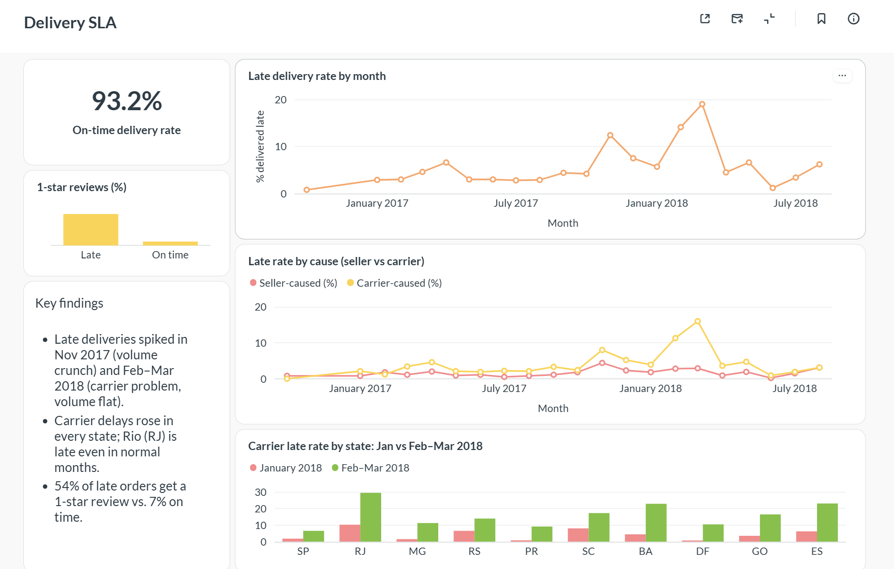
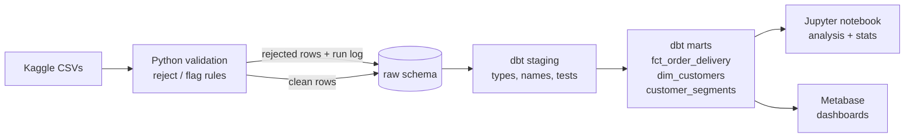
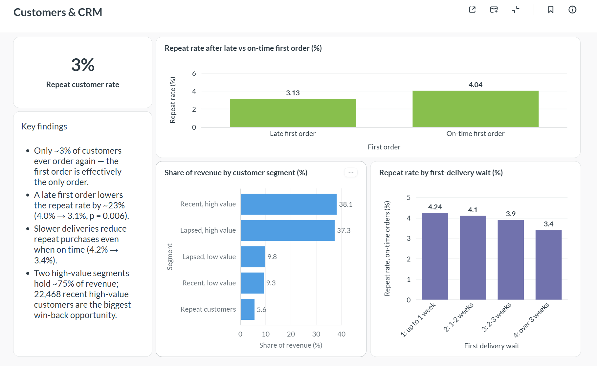
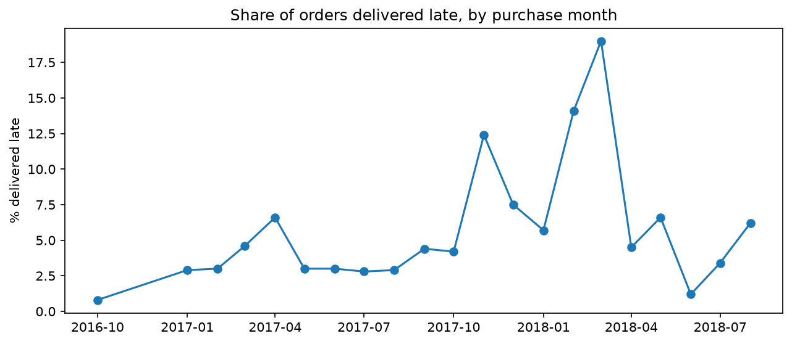
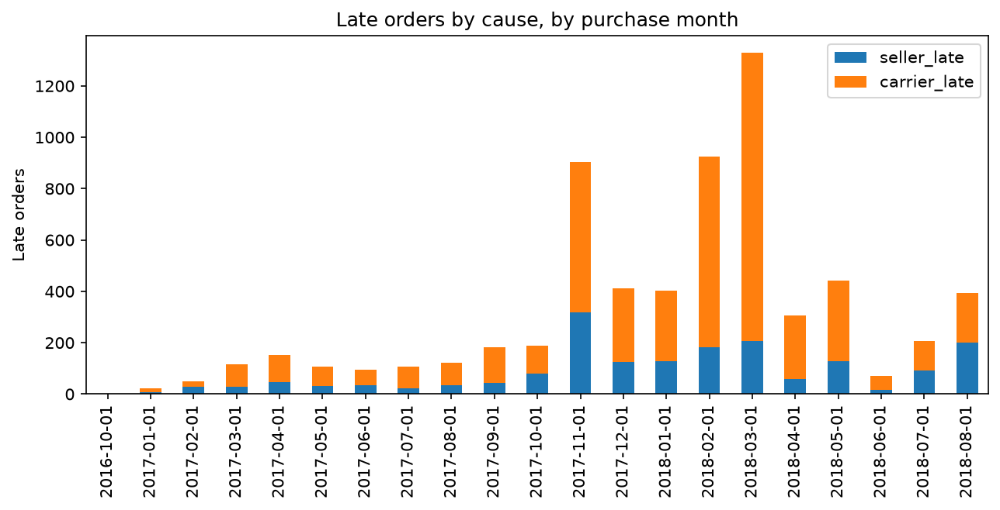
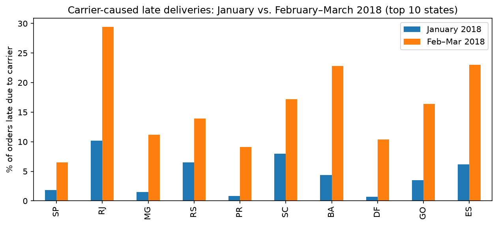
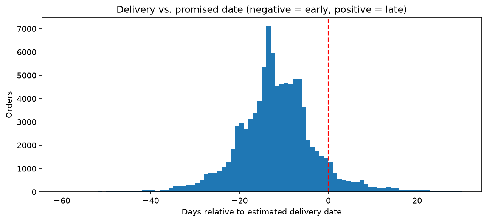

# Fulfillment Analytics Pipeline

**End-to-end data pipeline and analysis of delivery performance and customer retention for a Brazilian e-commerce marketplace (Olist, ~100k orders, 2016–2018).**

Raw CSVs are validated in Python, loaded into PostgreSQL (Docker), modelled and tested with dbt, analysed in a Jupyter notebook, and presented in two Metabase dashboards.

`Python` · `pandas` · `SQL` · `PostgreSQL` · `dbt` · `Docker` · `Jupyter` · `Metabase` · `statsmodels`



---

## Key findings

1. **On-time delivery looks good (93.2%) — but hides two spikes.** Late deliveries jumped to 12.4% in Nov 2017 and to 14.1% / 19.0% in Feb / Mar 2018.
2. **The two spikes had different causes.** November 2017 was a volume crunch (+63% orders) that hit sellers and carriers alike. Feb–Mar 2018 was a **transport problem**: volume was flat, seller-caused lateness barely moved (1.8% → 2.9%), but carrier-caused lateness quadrupled (3.9% → 16.0%).
3. **The carrier spike was network-wide, with a separate structural problem in Rio de Janeiro.** Carrier delays rose in all top-10 states. Rio (RJ) was already at 10.2% carrier-late in a normal month and hit 29.4% in Feb–Mar.
4. **Late deliveries drive bad reviews.** Late orders average 2.27/5 vs. 4.29/5 on time, and **53.8% of late orders get a 1-star review** (vs. 6.6%).
5. **A late first order lowers repeat purchasing by ~23%** (4.04% → 3.13%; two-proportion z-test, p = 0.006). **Slow deliveries hurt even when on time** (4.24% → 3.40% repeat rate for waits over three weeks).
6. **Delivery estimates are very conservative.** Promised delivery averages 24.4 days; actual delivery 12.5 days. 78.9% of orders arrive at least a week early.
7. **Retention is structurally low (~3%), and revenue is concentrated.** Two high-value segments hold ~75% of revenue; 22,468 recent high-value one-time buyers are the largest win-back opportunity.

Full analysis, code and charts: [`analysis/findings.ipynb`](analysis/findings.ipynb)

---

## Recommendations

- **Carrier performance review** for early 2018, including SLA terms in carrier contracts.
- **Treat Rio de Janeiro separately:** review routes, carriers and delivery estimates for RJ.
- **Calibrate delivery estimates per region** using actual delivery times — and **A/B test** shorter estimates, measuring both conversion and review scores (shorter promises risk more "late" orders, and late orders get 54% 1-star reviews).
- **CRM:** nurture recent high-value one-time buyers toward a second order; test a voucher for customers whose first order arrived late (A/B test vs. control, primary metric: second order within 90 days).

---

## Architecture



| Layer | What it does |
|---|---|
| **Validation (Python)** | Applies data-quality rules; rejects rows that break the SLA calculation, flags suspicious ones; fails the run if the rejection rate exceeds 0.1% |
| **Load (Python → Postgres)** | Writes all tables in a single transaction (all-or-nothing); safe to re-run (truncate-and-reload keeps downstream views intact); logs every run to `raw.pipeline_runs` |
| **Staging (dbt)** | Renames columns, fixes types (e.g. money as exact `numeric`), one model per source table |
| **Marts (dbt)** | Business logic: late / on-time, days late, seller vs. carrier attribution, customer history, RFM segmentation |
| **Tests (dbt)** | 29 tests: uniqueness, not-null, accepted values — including table grain (one row per order / per customer) |
| **Analysis** | Jupyter notebook: 9 questions, findings, charts, significance tests |
| **Dashboards** | Metabase: *Delivery SLA* and *Customers & CRM* |

---

## Data quality

Profiling the 99,441 raw orders surfaced these issues. Each rule was assigned an action based on whether it breaks the SLA calculation:

| Rule | Rows | Action | Reason |
|---|---|---|---|
| Delivered order has no delivery date | 8 | **Reject** | Cannot determine on-time vs. late |
| Delivered order has no approval date | 14 | Flag | SLA calculation still valid |
| Delivered order has no carrier handoff date | 2 | Flag | SLA calculation still valid |
| Canceled order has a delivery date | 6 | Flag | Contradictory, but outside SLA scope |
| Carrier handoff before payment approval | 1,359 | Flag | Median gap 17 h — most likely an approval-logging delay; excluded from root-cause analysis |
| Delivered before carrier handoff | 23 | Flag | Impossible timeline; delay cause set to `unknown` |

Other decisions: delivery dates are compared as **dates, not timestamps** (the estimated date has no time component); for orders with several reviews, the **latest** review is used; one review can cover several orders from the same cart, so reviews are unique per *review + order*, not per review. In production, the 1,359 approval-timing issues would be raised with the owner of the payments data.

---

## Dashboards

**Delivery SLA** — on-time rate, monthly trend, seller vs. carrier causes, review impact, state breakdown


**Customers & CRM** — repeat rate, effect of first-order experience, revenue by segment



---

## Selected charts

| | |
|---|---|
|  |  |
|  |  |

---

## Limitations

- **Associations, not proven causes.** Late orders may have other problems (damaged items); late deliveries are concentrated in certain states, which may have lower repeat rates for other reasons. A within-state comparison is the natural next step.
- **Carrier identity is not in the data**, so carrier-level analysis would need data from the logistics partner.
- **Seller vs. carrier attribution:** if a seller handed over late *and* transport was slow, the delay is attributed to the seller.
- **Low retention is likely structural** (marketplace model, infrequently purchased products), so delivery explains only part of it.
- **Repeat-rate analysis** includes only customers whose first order was before March 2018, so everyone had at least ~6 months to return.

## Next steps

- Repeat rate and late rate by **product category** (requires the `products` table)
- **Within-state** comparison of repeat rates
- Identify **repeatedly late sellers**
- Add a CI workflow (GitHub Actions) running `pytest` and `dbt test` on every push

---

## Project structure

```
fulfillment-analytics-pipeline/
├── src/
│   ├── profile_orders.py        # initial data profiling
│   ├── validate_orders.py       # data-quality rules, reject/flag, run metrics, threshold
│   └── load_to_postgres.py      # transactional, re-runnable load into Postgres
├── fulfillment_dbt/
│   └── models/
│       ├── staging/             # stg_orders, stg_order_items, stg_customers, stg_reviews + tests
│       └── marts/               # fct_order_delivery, dim_customers, customer_segments + tests
├── analysis/
│   └── findings.ipynb           # 9 questions, findings, charts, statistical tests
├── docs/                        # chart and dashboard images
├── docker-compose.yml           # Postgres + Metabase
├── requirements.txt
└── .env.example
```

---

## How to run

**Prerequisites:** Python 3.12, Docker Desktop, a Kaggle account.

1. **Get the data:** download the [Brazilian E-Commerce Public Dataset by Olist](https://www.kaggle.com/datasets/olistbr/brazilian-ecommerce) and unzip the CSVs into `data/raw/`. (The data is not included in this repository; see the Kaggle page for its licence.)

2. **Configure:** copy `.env.example` to `.env` and set a password.

3. **Start Postgres and Metabase:**
   ```bash
   docker compose up -d
   ```

4. **Install Python dependencies:**
   ```bash
   python -m venv .venv
   .venv\Scripts\activate          # Windows  (macOS/Linux: source .venv/bin/activate)
   pip install -r requirements.txt
   ```

5. **Validate and load:**
   ```bash
   python src/load_to_postgres.py
   ```

6. **Build and test the dbt models.** Create a dbt profile at `~/.dbt/profiles.yml`:
   ```yaml
   fulfillment_dbt:
     target: dev
     outputs:
       dev:
         type: postgres
         host: localhost
         port: 5433
         user: pipeline
         pass: <your password from .env>
         dbname: fulfillment
         schema: analytics
         threads: 4
   ```
   Then:
   ```bash
   cd fulfillment_dbt
   dbt run
   dbt test
   ```

7. **Explore:**
   - Notebook: `jupyter notebook analysis/findings.ipynb`
   - Metabase: http://localhost:3000 — connect to host `postgres`, port `5432` (Metabase runs inside the Docker network)

---

## Data source

[Brazilian E-Commerce Public Dataset by Olist](https://www.kaggle.com/datasets/olistbr/brazilian-ecommerce), Kaggle. Real, anonymised orders from 2016–2018. All revenue figures are in Brazilian reais (BRL).
